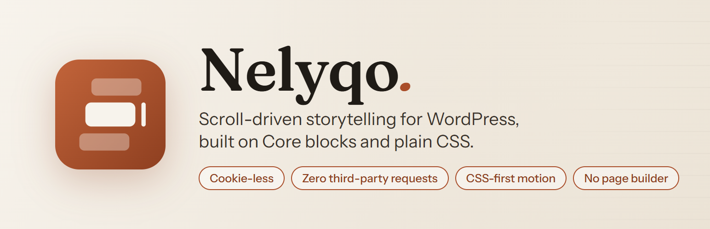
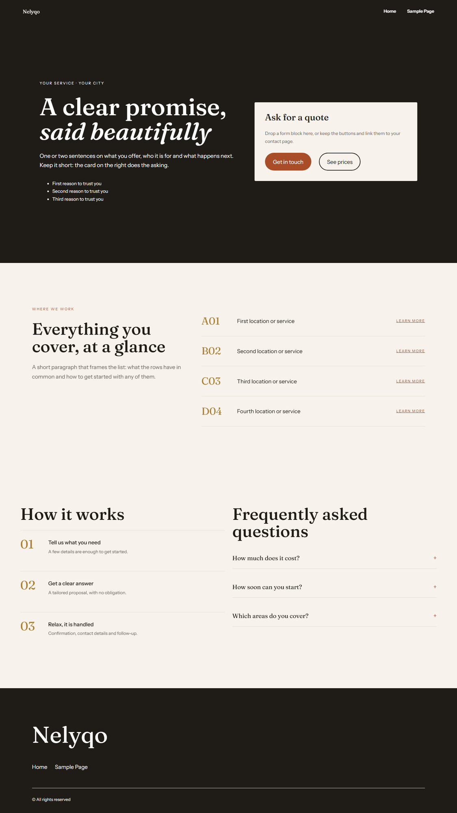
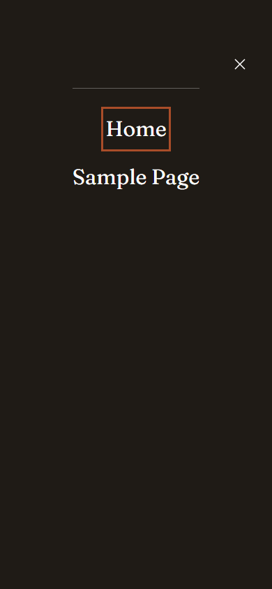
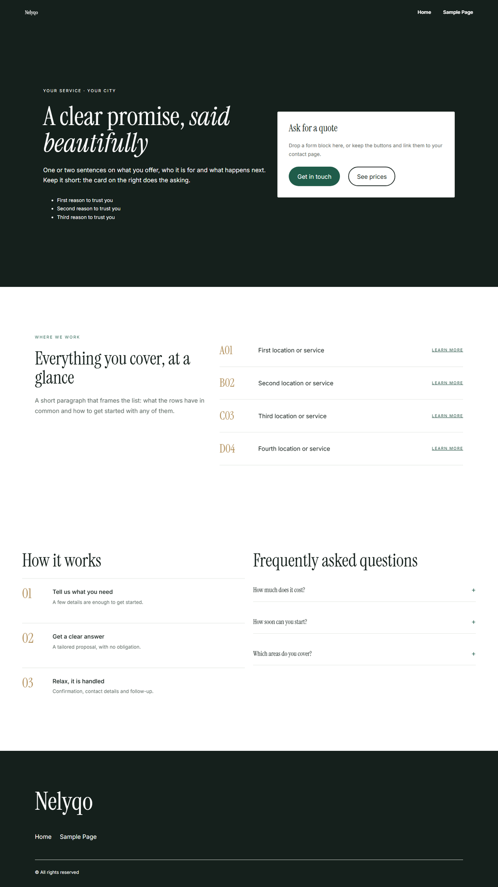
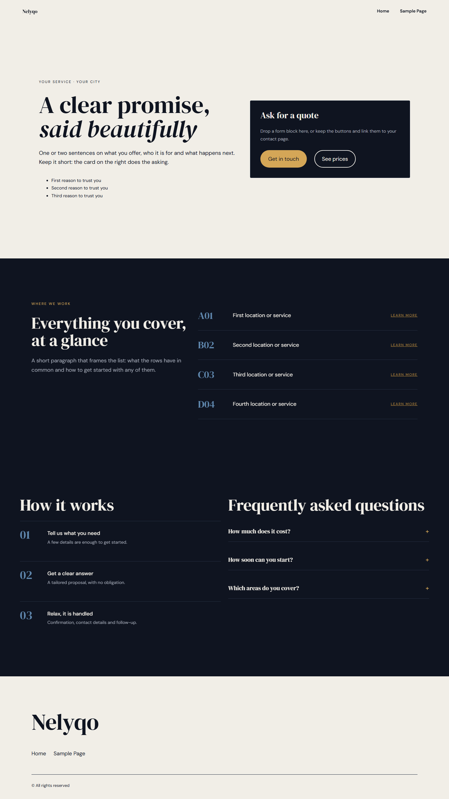

<p align="center">
  
</p>

<div align="center">

[](https://github.com/massimomazzariol/Nelyqo/actions/workflows/ci.yml)
[](https://github.com/massimomazzariol/Nelyqo/releases/latest)
[](https://wordpress.org)
[](https://www.php.net)
[](LICENSE)
[](https://playground.wordpress.net/?blueprint-url=https://raw.githubusercontent.com/massimomazzariol/Nelyqo/master/blueprint.json)
[](#cookie-less-by-design)
[](#cookie-less-by-design)

</div>

A WordPress block theme for scroll-driven storytelling: sections that hold still while you scroll, horizontal tracks, full-page sections and gentle reveals, built on Core blocks and `theme.json` with no page builder and almost no JavaScript.

**Cookie-less, fast, and yours to leave.** No cookies, no browser storage, no tracking, no calls to Google Fonts or CDNs, motion done in CSS, and content saved as plain Core blocks that survive a theme switch.

Made for small local businesses that sell on trust and booking requests (private drivers, guides, studios, B&Bs): one strong hero with a request card, clear lists, a short process and a FAQ.

**[Try the live demo in WordPress Playground](https://playground.wordpress.net/?blueprint-url=https://raw.githubusercontent.com/massimomazzariol/Nelyqo/master/blueprint.json)**: Nelyqo presents itself, every feature in one scroll from night to ivory. It runs in your browser, nothing to install.



Pre-1.0 and in active use on client sites. Block names (`nelyqo/*`) are stable; CSS class names may still change before 1.0.

## Why Nelyqo

Most themes that do scroll effects bring a page builder, an animation library, a slider script and a font CDN with them. Nelyqo does the same job with the browser and WordPress itself.

### Cookie-less by design

Nelyqo itself does not set cookies, use persistent browser storage, perform tracking, or make third-party requests on the public site. This is a [project rule](docs/PROJECT-PRINCIPLES.md#privacy-and-cookie-less-architecture), not a setting:

- No `document.cookie`, `localStorage`, `sessionStorage`, IndexedDB or service workers anywhere in the theme.
- No analytics, pixels or telemetry, and no "phone home" from the admin either.
- Fonts are self-hosted `woff2` files: visitors' IP addresses never go to Google Fonts or any other CDN.
- No embeds load on their own.

So the theme adds nothing to your cookie banner or your privacy policy. What plugins and WordPress login cookies do stays outside the theme, and Nelyqo does not tamper with them.

### Fast because there is little to load

- **Motion in CSS.** Sticky sections, the header that fills in on scroll and the reveal-on-scroll style use `position: sticky` and scroll-driven animations. No animation library, no scroll listeners for these effects.
- **JavaScript only where a block needs it.** The interactive blocks (Scroll section, Horizontal scroll, Full-page section) each load their own small script, 1.5-2.8 KB gzipped, and only on pages that use them. The patterns and block styles need none.
- **Small CSS.** The theme's global CSS is about 3 KB gzipped; each block's CSS loads only with the block.
- **Good defaults, switchable.** Theme fonts preloaded, no WordPress emoji script, autoplay videos loaded only near the viewport, leftover HTML comments removed.

### No lock-in

- Content is plain Core blocks (Group, Cover, Details, Image) with block styles on top. Switch theme and your pages are still there and readable.
- No page builder, no shortcodes, no hidden settings store, no required plugin.
- Plugin friendly: no broad CSS or JavaScript overrides, no assumptions about which SEO, cache or form plugin you use.

### Quiet and accessible

- **Discretion** switches hide versions, user names and old doors like XML-RPC, so the site tells less about how it is built.
- Keyboard operation, visible focus, semantic landmarks and `prefers-reduced-motion` are treated as correctness, not extras. Effects degrade to normal scrolling in browsers that lack them.

## What you get

**Block styles for Core blocks** (CSS only, content stays plain Core markup):

- **Group > Sticky section**: the Group's content holds still for a stretch of scrolling, then moves on. Good for heroes.
- **Group > Reveal on scroll**: headings, text, buttons and accordions inside the Group rise gently into view. Images stay still. Uses scroll-driven animations where the browser supports them, does nothing otherwise, and respects `prefers-reduced-motion`.

**Patterns** (Inserter > Patterns):

- **Hero with side card**: full-height cover with the pitch on the left and a call-to-action card on the right, using the Sticky section style.
- **Intro with coded list**: section intro next to a ruled list of rows with a short code, a name and a link (airports, branches, services).
- **Steps and FAQ**: a numbered three-step process next to a FAQ accordion on the Details block.

**Performance** (Appearance > Nelyqo, each switch on by default):

- Theme fonts preloaded, autoplay videos loaded only near the viewport.
- No WordPress emoji script.
- No plugin signature comments (name and timing), turned off through each plugin's own switch.
- No HTML comments in the page sent to visitors: removed on the way out only when there are some, never inside scripts, styles or preformatted text. Files and saved content are untouched.

**Discretion** (Appearance > Nelyqo, each switch on by default): pages say less about how the site is built and expose fewer doors.

- No WordPress or PHP version in the page, asset addresses or headers.
- No links announcing the API, editing apps, short links and embeds (the features keep working).
- XML-RPC off: the old remote-publishing door often used to guess passwords.
- User names hidden from visitors: no user list in the API, no author pages, no author in embeds or the sitemap.

**Header**:

- On the front page the header floats over the first section, starts transparent and fills in during the first 140px of scrolling.
- Below 900px the menu collapses to a full-screen overlay with large heading-font items.
- Child themes can change the fill with one custom property: `--nelyqo-header-fill`.



**Custom blocks**: Hero, Pills, Scroll section and Scroll card, Horizontal scroll (with track, content and intro card), Full-page section.

**Accordion**: the Details block becomes a FAQ accordion with a plus sign that turns into a cross.

**Design system**: semantic color slugs, self-hosted fonts and motion tokens, documented in the [style guide](docs/STYLE-GUIDE.md). Three looks, switchable in **Appearance > Editor > Styles**:

| Default: warm editorial | Modern clean | Night |
| --- | --- | --- |
| Ivory, ink, terracotta. Fraunces + Instrument Sans | White, forest green, brass. Instrument Serif + Inter | Midnight blue, gold. DM Serif Display + DM Sans |
|  |  |  |

## Requirements

- WordPress 6.9 or later (tested up to 7.1)
- PHP 8.2 or later

## Install

Download `nelyqo-x.y.z.zip` from the [latest release](https://github.com/massimomazzariol/Nelyqo/releases/latest) and upload it in **Appearance > Themes > Add New > Upload Theme**, or clone it into `wp-content/themes/nelyqo`. Block builds are committed, so no Node.js is needed to run the theme.

## Child themes

Nelyqo loads its own stylesheets from the parent directory, so a child theme only enqueues what it adds. Override the header fill, palette and fonts in the child's `theme.json` and CSS; keep the parent's class names (`nelyqo-site-header`, `nelyqo-site-header__main`) in custom header parts to inherit the header behavior.

## Development

Requires Node.js 22 and pnpm 10. Point any local WordPress at the repository (WordPress Studio, `wp-env` with the included `.wp-env.json`, or a symlink).

```sh
pnpm install
pnpm build   # build all blocks
pnpm check   # lint JS and CSS, then build
```

CI runs the same checks, lints the PHP files and rejects uncommitted build output.

Read the [project principles](docs/PROJECT-PRINCIPLES.md) before architectural changes.

## License

GPL-2.0-or-later. Copyright 2026 Massimo Mazzariol, [https://github.com/massimomazzariol/Nelyqo](https://github.com/massimomazzariol/Nelyqo). If you reuse the code, keep the copyright notices and the [NOTICE](NOTICE) file.
